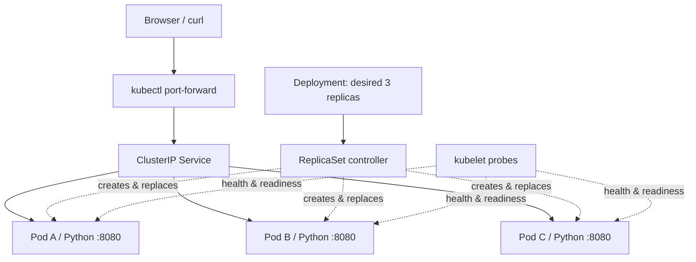

# 🛟 KubeRescue

**A hands-on Kubernetes self-healing lab you can run, break, and verify locally.**

[](https://github.com/fuhrdan/kuberescue/actions/workflows/ci.yml)


KubeRescue runs a minimal, **dependency-free Python HTTP service** as three Kubernetes replicas. A failure demonstration deletes a live Pod, waits for Kubernetes to reconcile the Deployment, and **verifies replacement using the new Pod's UID**. A second demonstration deploys a new Docker image through a rolling update. GitHub Actions repeats both scenarios on every pull request.

> **What this proves:** desired-state reconciliation, Pod replacement, liveness/readiness/startup probes, multi-node scheduling, ClusterIP Services, non-root container security, a rolling Deployment, and a real Kubernetes CI integration test.
>
> **What it does not prove:** zero downtime under every failure, automatic repair of all application bugs, or high availability during a full cluster outage. See [limitations](#limitations).

## Architecture



The **Service** has three eligible backends in steady state. `kubectl port-forward service/kuberescue` typically selects **one Pod for the tunnel**, so refreshing the dashboard does **not** demonstrate load balancing. Use `kubectl get pods -o wide` to see all replicas.

### What you'll see

The browser dashboard at **http://localhost:8080** displays the responding Pod's name, Kubernetes node, application version, process uptime, and request count. Its self-healing diagram explains the exact experiment to run in a separate terminal.

## Quick start (Windows PowerShell)

**Requirements:** Docker Desktop (Linux containers and Kubernetes-compatible Docker engine), [kind](https://kind.sigs.k8s.io/docs/user/quick-start/), [kubectl](https://kubernetes.io/docs/tasks/tools/), Python **3.10+**, and optionally Git. Allocate **at least 4 GB** of memory to Docker Desktop; the default lab creates a control plane and two worker nodes. No cloud account or paid service is needed.

From PowerShell in the extracted repository folder:

```powershell
# One-time setup: create a local cluster, build image, deploy 3 replicas
.\scripts\setup.ps1

# In terminal 1: expose the demo app on your computer
kubectl --context kind-kuberescue -n kuberescue port-forward svc/kuberescue 8080:80

# In terminal 2: deliberately delete a Pod and prove recovery
python .\scripts\demo_failure.py

# Build and roll out a v2 image (when ready)
.\scripts\demo-rollout.ps1

# Destroy only the dedicated training cluster (when finished)
.\scripts\cleanup.ps1
```

Then browse to **http://localhost:8080**. Run the failure demo from the repository root, **not** from a production Kubernetes context. The script explicitly pins all commands to `kind-kuberescue` and namespace `kuberescue`.

> PowerShell execution policies may block local `.ps1` scripts. Follow your organization's approved script execution policy; all commands are also documented below for manual execution.

## Quick start (Linux / macOS)

Install [Docker](https://docs.docker.com/get-docker/), `kind`, `kubectl`, and Python 3.10+. Then:

```bash
./scripts/setup.sh
kubectl --context kind-kuberescue -n kuberescue port-forward svc/kuberescue 8080:80
# In another terminal, from the repo root:
python3 scripts/demo_failure.py
./scripts/demo-rollout.sh
# Optional cleanup:
./scripts/cleanup.sh
```

The setup script can be rerun and restores the initial `v1` deployment after the v2 demo.

## Five hands-on exercises

### 1. Inspect the deployment

```bash
kubectl --context kind-kuberescue -n kuberescue get deployments
kubectl --context kind-kuberescue -n kuberescue get pods -o wide
kubectl --context kind-kuberescue -n kuberescue get service kuberescue
kubectl --context kind-kuberescue -n kuberescue get endpointslice -l kubernetes.io/service-name=kuberescue
```

Expected steady state: Deployment `READY` **3/3**. With three kind nodes (one control plane, two workers), Pod scheduling can be spread across worker nodes. Placement may vary.

### 2. Verify the service and health probes

With port-forward running in a separate terminal:

```bash
curl http://127.0.0.1:8080/healthz
# {"status":"alive"}

curl http://127.0.0.1:8080/readyz
# {"status":"ready"}

curl http://127.0.0.1:8080/api/info
# JSON with pod, node, namespace, version, uptime, requests_served, ready
```

See `k8s/deployment.yaml` for `startupProbe`, `livenessProbe`, and `readinessProbe`. A failed readiness check removes a Pod from Service endpoints; a failed liveness check can restart its container. **Deleting a Pod** (exercise 3) is a distinct event: the ReplicaSet controller creates a new Pod.

### 3. Delete a Pod and verify self-healing

```bash
python3 scripts/demo_failure.py --timeout 180
```

Representative output (names and times vary):

```text
Context: kind-kuberescue (explicitly pinned; safe local lab)
Initial ready: 3/3; Pod UIDs recorded
Deleting Pod kuberescue-7d...-abcde (UID 915...) ...
Ready: 2/3; visible Pod objects: 3
Ready: 3/3; visible Pod objects: 3
PASS: kuberescue-7d...-fghij has a NEW UID
Self-healing verified: 3/3 ready after 8.4s
```

The script only declares success after the **deleted UID is gone**, the target replica count is fully ready, and **a UID that did not exist before the test** has appeared. This is much stronger evidence than simply seeing three running Pods.

### 4. Roll out a new application version

```bash
# Linux / macOS
./scripts/demo-rollout.sh

# Windows PowerShell
.\scripts\demo-rollout.ps1
```

This builds `kuberescue:v2`, loads it into the local kind nodes, updates the Deployment image, and waits for the rolling update to finish. Refresh the dashboard to see `v2` (re-establish port-forward if its selected Pod was terminated). For a rollback:

```bash
kubectl --context kind-kuberescue -n kuberescue rollout undo deployment/kuberescue
kubectl --context kind-kuberescue -n kuberescue rollout status deployment/kuberescue
```

The rollback requires the previously deployed `v1` image to still be available in the kind nodes; the setup process ensures that.

### 5. Scale the deployment

```bash
kubectl --context kind-kuberescue -n kuberescue scale deployment/kuberescue --replicas=5
kubectl --context kind-kuberescue -n kuberescue rollout status deployment/kuberescue
kubectl --context kind-kuberescue -n kuberescue get pods -o wide

# Return to the repository's default desired state:
kubectl --context kind-kuberescue -n kuberescue scale deployment/kuberescue --replicas=3
```

This is **manual scaling**, not an HPA demonstration; an autoscaler is intentionally out of scope for this beginner lab.

## Run the tests without Kubernetes

No `pip install` is necessary:

```bash
python -m unittest discover -s tests -v
python -m app.main
# Separate terminal: curl http://localhost:8080/api/info
```

The test suite covers HTTP endpoints, response headers, delayed readiness, Pod metadata, errors, and UID-based recovery logic. GitHub Actions also exercises a **real kind cluster** and an end-to-end rolling update.

## Repository contents

```text
kuberescue/
├── .github/
│   ├── workflows/ci.yml       # Unit tests + live Kubernetes integration
│   ├── dependabot.yml         # Weekly GitHub Actions / Docker updates
│   ├── ISSUE_TEMPLATE/        # Reproducible bug report template
│   └── pull_request_template.md
├── app/
│   ├── main.py                # Python HTTP service and probes
│   └── static/index.html      # Browser diagnostic dashboard
├── docs/
│   ├── architecture.md        # Design and limitations
│   └── interview-walkthrough.md
├── k8s/
│   ├── kind-config.yaml       # One control plane, two worker nodes
│   ├── namespace.yaml
│   ├── deployment.yaml        # Three replicas and security/probes
│   └── service.yaml           # ClusterIP Service
├── scripts/
│   ├── setup.sh / setup.ps1
│   ├── demo_failure.py        # Verifies a new Pod UID
│   ├── demo-rollout.sh / demo-rollout.ps1
│   └── cleanup.sh / cleanup.ps1
├── tests/
│   ├── test_app.py
│   └── test_demo_failure.py
├── Dockerfile
├── LICENSE
└── README.md
```

## What happens in GitHub Actions?

On pull requests, pushes to `main`, or manual dispatch, `.github/workflows/ci.yml`:

1. Runs Python's built-in unit/HTTP tests (no downloaded dependencies).
2. Creates an isolated three-node kind cluster on a GitHub-hosted Linux runner.
3. Builds and loads the `v1` Docker image, deploys and waits for three ready replicas.
4. Deletes one Pod and proves replacement using its UID.
5. Builds and deploys `v2` through a rolling update, then checks that a v2 Pod responds over HTTP.

CI is the evidence: after publishing, open the repository's **Actions** tab to see actual results. A workflow file existing in the repository is **not** proof the integration has passed until GitHub executes it.

## Publish to GitHub

This package is prepared for the repository **`fuhrdan/kuberescue`**, but no remote repository is created by this ZIP.

**Option A — GitHub CLI installed and authenticated:**

```bash
cd kuberescue
git init -b main
git add .
git commit -m "feat: add Kubernetes self-healing training lab"
gh repo create fuhrdan/kuberescue --public --source=. --remote=origin --push
```

**Option B — GitHub website:** create an **empty**, public repository named `kuberescue` under `fuhrdan` (do not initialize with a README, because this project already has one), then from this directory:

```bash
git init -b main
git add .
git commit -m "feat: add Kubernetes self-healing training lab"
git remote add origin https://github.com/fuhrdan/kuberescue.git
git push -u origin main
```

Suggested GitHub **About** description:

> Hands-on Kubernetes self-healing lab: Python, Docker, 3-replica Deployment, health probes, Pod failure recovery, rolling updates, and kind CI.

Suggested topics: `kubernetes`, `docker`, `kind`, `python`, `devops`, `self-healing`, `github-actions`, `cloud-native`, `portfolio-project`.

## Security and limitations

- All scripts explicitly target a **local kind cluster** (`kind-kuberescue`) and the dedicated `kuberescue` namespace. Don't repurpose the failure script for a production cluster.
- The dashboard is intended for **localhost training**, not public Internet exposure. It is a small example service, not a production-authenticated application.
- KubeRescue runs without Kubernetes API permissions; metadata uses the [Downward API](https://kubernetes.io/docs/concepts/workloads/pods/downward-api/).
- The container uses a non-root UID, a read-only root filesystem, no extra Linux capabilities, and resource limits; this is not a complete container security assessment.
- The rollout strategy permits **one unavailable Pod**; it does not guarantee continuous availability for every fault. A single service or node can still fail.
- Multi-node kind is **one Docker host**, not separate physical fault domains. It does not simulate cloud-region outages.
- A service port-forward is a debugging tunnel and usually remains pinned to one backend Pod, rather than proving per-request Service distribution.
- The project does not require cloud credentials, a registry, Helm, databases, or third-party Python packages.

## Troubleshooting

| Symptom | Try this |
| --- | --- |
| `kind: command not found` | Install kind and restart your shell; confirm `kind version`. |
| Docker error or no Linux containers | Start Docker Desktop and switch to Linux containers. |
| Pods show `ImagePullBackOff` | Run `kind load docker-image kuberescue:v1 --name kuberescue`; keep `imagePullPolicy: IfNotPresent`. |
| Pods stay `Pending` | Run `kubectl --context kind-kuberescue -n kuberescue describe pods`; increase Docker memory if needed. |
| `localhost:8080` won't open | Start `kubectl ... port-forward ... 8080:80` in a separate terminal, and check that 8080 is free. |
| Dashboard disconnects during rollout | Re-run `port-forward`: the Pod selected for the tunnel may have been replaced. |
| PowerShell refuses `.ps1` | Review your local execution policy; alternatively run the equivalent documented commands manually. |

See [architecture notes](docs/architecture.md) and the [5-minute interview walkthrough](docs/interview-walkthrough.md).

## Further reading

- [Kubernetes self-healing](https://kubernetes.io/docs/concepts/architecture/self-healing/)
- [Deployments and rolling updates](https://kubernetes.io/docs/concepts/workloads/controllers/deployment/)
- [Configure liveness, readiness and startup probes](https://kubernetes.io/docs/tasks/configure-pod-container/configure-liveness-readiness-startup-probes/)
- [kind quick start and loading Docker images](https://kind.sigs.k8s.io/docs/user/quick-start/)

**MIT licensed · Designed as a learning lab and portfolio demonstration.**
